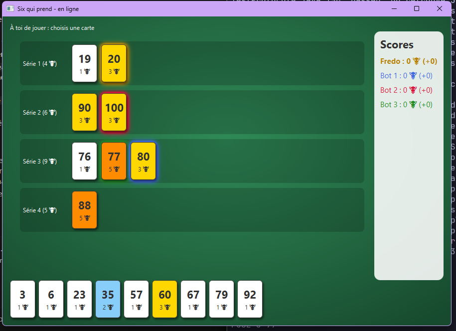

# Six qui prend

## Présentation

Adaptation en Java du jeu de cartes **6 qui prend !** (Wolfgang Kramer, 1994). À chaque tour, les joueurs posent une carte en même temps. Les cartes viennent compléter quatre séries, et celui qui pose la 6e carte d'une série la ramasse avec toutes ses têtes de bœuf. La partie s'arrête dès qu'un joueur dépasse 66 têtes, et c'est le joueur qui en a le moins qui gagne.

Ce projet a été réalisé dans le cadre du cours de programmation orientée objet en Java à l'esaip.

- La **V1** correspond à la version rendue pour le TP : le jeu complet en console.
- La **V2** ajoute quatre niveaux de bots avec un benchmark, une **interface graphique JavaFX** animée, et un **mode multijoueur en ligne** (client-serveur en TCP, jouable entre plusieurs PC).

<!-- Capture d'écran : enregistre une image de partie dans docs/partie-en-ligne.png -->


## Prérequis

- Un **JDK Java** récent (Java 17 au minimum pour la console, les tests et le serveur).
- Le **SDK JavaFX** pour l'interface graphique (le projet est développé avec JavaFX 27). Il faut un JDK compatible avec la version de JavaFX installée : voir les prérequis sur le site de Gluon.
- Sous Windows, le script `lancer.bat` compile puis lance chaque partie du projet. Le chemin de JavaFX se règle en haut du script (`set FX=...`).

## Lancer le projet

Toutes les commandes se tapent à la racine du projet. Le script compile toujours avant de lancer, et ne lance **rien** si la compilation échoue.

| Commande | Ce qu'elle lance |
| --- | --- |
| `.\lancer.bat fx` | le jeu graphique en local, contre 1 à 9 bots |
| `.\lancer.bat console` | le jeu en console (la V1) |
| `.\lancer.bat tests` | les tests unitaires (`TestJeu`, `TestProtocole`, `TestEtatClient`) |
| `.\lancer.bat bench` | le benchmark des bots |
| `.\lancer.bat serveur H B` | le serveur de jeu en ligne, pour `H` humains et `B` bots |
| `.\lancer.bat enligne` | le client graphique pour jouer en ligne |
| `.\lancer.bat auto PSEUDO` | un client automatique (il joue toujours sa première carte), pratique pour les tests |
| `.\lancer.bat texte [adresse]` | un client en mode texte, pour taper les messages du protocole à la main |
| `.\lancer.bat clientfx` | une console graphique qui affiche les messages échangés avec le serveur |

Sans argument, `.\lancer.bat` affiche la liste des cibles.

## Le jeu graphique (JavaFX)

- **Écran d'accueil** : choix du nombre de bots (1 à 9) et de leur niveau.
- **La table** : les quatre séries au centre, la main du joueur en bas et les scores à droite, avec une couleur par joueur.
- **Les tours animés** : les cartes se posent une par une, dans l'ordre croissant. Chaque carte du dernier tour a un **halo** à la couleur du joueur qui l'a posée, et une bulle d'aide indique son nom au survol.
- **Les ramassages** : un « +N 🐮 » monte sur la ligne du joueur qui ramasse. Quand la carte du joueur est trop petite, les séries s'éclairent et il clique sur celle qu'il veut ramasser.
- **La fin de partie** : un écran affiche le classement, avec la possibilité de rejouer ou de quitter.

## Le jeu en ligne

### Jouer sur un seul PC

1. Dans un premier terminal : `.\lancer.bat serveur 2 2` (2 humains et 2 bots).
2. Dans deux autres terminaux : `.\lancer.bat enligne`, puis garder l'adresse `localhost`, choisir un pseudo et cliquer sur « Rejoindre ».

La partie démarre quand tous les humains attendus sont connectés. Le serveur complète ensuite avec les bots (niveau MOYEN) et enchaîne les manches tout seul.

### Jouer entre deux PC du réseau local

Le serveur n'utilise aucune classe de JavaFX : il peut donc tourner sur une machine sans écran, par exemple un serveur Linux.

**Sur la machine serveur** (ici sous Linux, seuls les dossiers `modele` et `reseau` sont nécessaires) :

```bash
javac -d out modele/*.java reseau/*.java
java -cp out reseau.ServeurJeu 2 2
```

- Le serveur écoute sur le **port TCP 5555**, sur toutes les interfaces.
- Si un pare-feu est actif sur cette machine, il faut ouvrir ce port en **entrée** (par exemple `sudo ufw allow 5555/tcp`).
- Pour que le serveur continue à tourner après la fermeture d'une session SSH, on peut le lancer dans `tmux`.

**Sur chaque machine joueur :** `.\lancer.bat enligne`, puis taper l'**adresse IP** du serveur à la place de `localhost`.

Pour vérifier le chemin réseau avant de jouer (PowerShell) :

```powershell
Test-NetConnection 192.168.1.133 -Port 5555     # doit afficher TcpTestSucceeded : True
```

Les clients n'ouvrent que des connexions **sortantes** : il n'y a rien à ouvrir dans le pare-feu des machines joueurs.

### Robustesse

| Situation | Ce qui se passe |
| --- | --- |
| Un joueur ferme sa fenêtre en pleine partie | Un **bot prend sa place** (son nom devient « pseudo (bot) ») et la partie continue pour les autres, même s'il fallait attendre sa carte ou son choix de série. |
| Le serveur s'arrête | Le client affiche « Connexion perdue avec le serveur » et désactive les clics. |
| Pseudo vide, trop long ou déjà pris (sans tenir compte des majuscules) | Le serveur refuse avec un message d'erreur. Le joueur peut réessayer sur la même connexion. |
| Serveur injoignable | L'écran de connexion l'indique, et on peut recliquer une fois le serveur lancé. |
| Message invalide (carte absente de la main, mauvais numéro de série, commande inconnue…) | Le serveur répond `ERREUR` et ignore le message : **le serveur ne fait jamais confiance au client**. |

### Le protocole

Les messages sont des lignes de texte. Le premier mot est la commande et la suite contient les données. Les joueurs sont toujours désignés par leur **position** (0, 1, 2…), dans l'ordre du message `JOUEURS`.

**Du client vers le serveur :**

| Message | Exemple | Rôle |
| --- | --- | --- |
| `NOM <pseudo>` | `NOM Fred` | rejoindre la partie |
| `CARTE <valeur>` | `CARTE 42` | jouer une carte de sa main |
| `SERIE <numéro>` | `SERIE 2` | choisir la série à ramasser (de 0 à 3) |

**Du serveur vers le client :**

| Message | Exemple | Rôle |
| --- | --- | --- |
| `BIENVENUE <position>` | `BIENVENUE 1` | le pseudo est accepté, voici ta position |
| `JOUEURS <nom>;<nom>;…` | `JOUEURS Fred;Alice;Bot 1` | les noms des joueurs, dans l'ordre des positions |
| `MAIN <v> <v> …` | `MAIN 3 15 27 42` | ta main (renvoyée après chaque carte jouée) |
| `SERIES <cartes>\|<cartes>\|…` | `SERIES 10,22\|30\|45,47\|90` | les quatre séries |
| `SCORES <total>,<pile>\|…` | `SCORES 12,3\|8,0\|15,5` | pour chaque joueur, ses têtes des manches précédentes et celles ramassées dans la manche en cours |
| `A_TOI_DE_JOUER` | | choisis une carte |
| `POSE <position> <valeur>` | `POSE 2 47` | une carte vient d'être posée |
| `RAMASSE <position> <gain>` | `RAMASSE 0 5` | un joueur vient de ramasser une série |
| `CHOISIS_SERIE` | | ta carte est trop petite : choisis la série à ramasser |
| `ATTENTE_SERIE <position>` | `ATTENTE_SERIE 1` | un autre joueur choisit sa série |
| `FIN_MANCHE` | | la manche est terminée |
| `FIN_PARTIE <position>;<position>;…` | `FIN_PARTIE 2;0;1` | le classement final, du premier au dernier |
| `ERREUR <texte>` | `ERREUR Cette carte n'est pas dans ta main` | le message précédent est refusé |

**Déroulement d'un tour.** Quand tous les humains ont joué leur carte, le serveur pose les cartes une par une. Après **chaque** étape, il envoie `POSE`, éventuellement `RAMASSE`, puis `SERIES` et `SCORES`. Le client range les messages dans une **file d'attente** et fait une courte pause à la fin de chaque étape : c'est ce qui lui permet de rejouer les animations du tour carte par carte, comme en local.

## Les bots

| Bot | Stratégie |
| --- | --- |
| ALEATOIRE | Joue une carte au hasard et ramasse une série au hasard. Il sert de point de comparaison. |
| FACILE | Joue toujours sa plus petite carte. Quand il doit ramasser, il choisit la série qui contient le moins de têtes. |
| MOYEN | Joue la carte la plus proche de la fin d'une série, en écartant les cartes dangereuses (trop petites, ou qui seraient la 6e carte). Si toutes ses cartes sont dangereuses, il joue la plus petite. |
| DIFFICILE | Donne à chaque carte une **note de risque** : écart avec la série ÷ places restantes dans la série. Une carte qui suit de près une série presque vide est sûre, alors qu'une carte éloignée d'une série presque pleine risque d'être devancée. Il joue la carte la moins risquée. Si toutes ses cartes sont dangereuses, il joue celle qui lui fera ramasser le moins de têtes. |

## Résultats du benchmark

Les chiffres varient légèrement d'une exécution à l'autre (de quelques pour cent), mais le classement reste le même.

### Tournoi à 4 bots (1000 parties)

| Bot | Victoires | Score moyen (têtes) |
| --- | --- | --- |
| DIFFICILE | 529 | 27,3 |
| MOYEN | 409 | 31,2 |
| FACILE | 28 | 59,6 |
| ALEATOIRE | 10 | 71,2 |

Il y a eu 24 parties terminées sur une égalité pour la première place. Elles ne sont attribuées à aucun bot.

### Duels (1000 parties chacun)

| Duel | Victoires | Matchs nuls |
| --- | --- | --- |
| ALEATOIRE vs FACILE | 307 - 684 | 9 |
| ALEATOIRE vs MOYEN | 14 - 985 | 1 |
| ALEATOIRE vs DIFFICILE | 17 - 983 | 0 |
| FACILE vs MOYEN | 51 - 947 | 2 |
| FACILE vs DIFFICILE | 28 - 969 | 3 |
| MOYEN vs DIFFICILE | 457 - 542 | 1 |

**Analyse :**

- **La hiérarchie est respectée dans tous les duels** : chaque niveau bat tous les niveaux inférieurs.
- **Le plus grand écart sépare FACILE et MOYEN.** Éviter les cartes dangereuses compte beaucoup plus que jouer petit.
- **Le duel MOYEN contre DIFFICILE est le plus serré.** À deux joueurs, les séries se remplissent moins vite, donc les 6e cartes sont plus rares. Or c'est justement là que la note de risque de DIFFICILE fait la différence. À 4 joueurs, l'écart est plus net : 12 points (53 % contre 41 %), contre 8 points en duel (54 % contre 46 %).

## Architecture

```text
sixQuiPrend/
├── Application.java        interface console (V1)
├── ApplicationFX.java      jeu graphique en local
├── BenchmarkBots.java      tournoi automatique entre bots
├── lancer.bat              compile et lance chaque partie du projet
├── style.css               le style de l'interface graphique (table, cartes, halos, couleurs)
├── modele/                 les règles du jeu, sans aucun affichage
│   ├── Jeu.java                déroulement d'un tour (étape par étape), d'une manche et d'une partie
│   ├── InfosPartie.java        ce qu'une vue a besoin de savoir sur une partie (interface)
│   ├── EtatTour.java           CARTE_POSEE, ATTENTE_CHOIX ou TOUR_FINI
│   ├── Carte, Serie, Main, Pile, Pioche, Joueur, CarteJouee
│   ├── TypeBot.java            les 4 niveaux de bots (enum)
│   ├── StrategieBot.java       interface commune à tous les bots
│   └── BotAleatoire, BotFacile, BotMoyen, BotDifficile
├── vue/                    les composants JavaFX
│   └── CarteVue, PlateauVue, MainVue, ScoresVue, FinPartieVue
├── reseau/                 le serveur et le protocole
│   ├── ServeurJeu.java         le serveur de jeu (un thread par client)
│   ├── ClientJeu.java          côté serveur : la connexion avec un joueur
│   ├── Protocole.java          encodage et décodage des messages
│   ├── ClientTexte, ClientAuto clients de test
│   └── ServeurEcho, ServeurChat…   exercices d'apprentissage des sockets
├── client/                 le client graphique en ligne
│   ├── ApplicationReseauFX.java    écran de connexion + écran de jeu en ligne
│   ├── Connexion.java              le socket, avec un thread de lecture
│   ├── EtatClient.java             la partie vue par le client, reconstruite à partir des messages
│   └── ConsoleReseauFX.java        console de débogage du protocole
└── test/                   tests unitaires
```

**Séparation des règles et de l'affichage.** Toutes les règles se trouvent dans `modele/`, qui n'importe ni JavaFX ni rien du réseau. C'est ce qui permet au benchmark de jouer des milliers de parties sans écran, et au serveur de tourner sur une machine sans interface graphique.

**Les bots et le polymorphisme.** Chaque bot est une classe qui implémente l'interface `StrategieBot`, avec deux méthodes : `choisirCarte` et `choisirSerie`. `Jeu` ne connaît pas les différents bots : il demande simplement au joueur sa stratégie et l'appelle. Pour **ajouter un nouveau bot**, il suffit de :

1. créer une classe `BotXxx implements StrategieBot` ;
2. ajouter la valeur dans `TypeBot` et une ligne dans sa méthode `creerStrategie()`.

Il n'y a aucune modification à faire dans `Jeu`. Le benchmark prend automatiquement en compte le nouveau bot dans les duels. La même idée permet de **remplacer un joueur déconnecté par un bot** en cours de partie : il suffit de lui donner une stratégie.

**Les mêmes vues en local et en ligne.** Les vues (`PlateauVue`, `MainVue`, `ScoresVue`) ne dépendent pas de `Jeu` mais de l'interface `InfosPartie`. Deux classes l'implémentent :

- `Jeu`, qui connaît toute la partie, pour le jeu local ;
- `EtatClient`, qui ne connaît que ce que le serveur lui a envoyé, pour le jeu en ligne.

Les vues affichent donc l'une ou l'autre sans changer une ligne de leur code.

**Le serveur décide.** En ligne, le client ne fait qu'envoyer des demandes (`CARTE`, `SERIE`) et afficher ce que le serveur lui renvoie. Il ne retire même pas lui-même la carte jouée de sa main : il attend le message `MAIN` du serveur. Toutes les règles sont appliquées **une seule fois**, côté serveur, ce qui évite que les joueurs se retrouvent avec des états différents.

## Tests

- `test.TestJeu` : les règles, les bots, le tour étape par étape, le contrat `InfosPartie` et le remplacement d'un joueur par un bot (120 tests).
- `test.TestProtocole` : l'encodage et le décodage de chaque message, avec des tests d'aller-retour (25 tests).
- `test.TestEtatClient` : la reconstruction de la partie côté client à partir des messages reçus (18 tests).
- Une classe de test par classe du modèle : `TestCarte`, `TestSerie`, `TestMain`, `TestPile`, `TestPioche` et `TestJoueur`.

## Versions

- **v1** (tag git `v1`) : version rendue pour le TP. Jeu complet en console contre des bots aléatoires.
- **v2** :
  - les règles sont extraites dans `Jeu` et testées ;
  - quatre niveaux de bots, un benchmark et une stratégie par classe (`StrategieBot`) ;
  - une interface graphique JavaFX : table de jeu, tours animés carte par carte, halos de couleur par joueur, gains animés et écran de fin de partie ;
  - le multijoueur en ligne : serveur TCP multi-thread, protocole texte, client graphique avec les mêmes vues que le jeu local, remplacement des joueurs déconnectés par des bots, et parties testées entre deux PC du réseau local.
